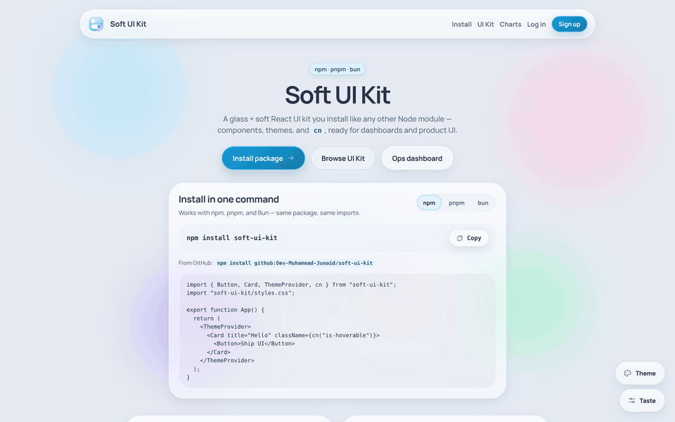

# Soft UI Kit

Glass + soft React UI kit — install it like any other Node module, then import components, themes, and `cn`.

<p align="center">
  <a href="https://dev-muhammad-junaid.github.io/soft-ui-kit/">
    
  </a>
</p>

<p align="center">
  <a href="https://dev-muhammad-junaid.github.io/soft-ui-kit/"><strong>Live demo →</strong></a>
</p>

**Promo video:** [landscape 16:9](docs/promo/soft-ui-kit-landscape-16x9.mp4) · [vertical 9:16 for Reels and Shorts](docs/promo/soft-ui-kit-vertical-9x16.mp4). Built with HyperFrames from the kit's own components; see [`promo/`](promo/README.md).

---

## Install

```bash
npm install soft-ui-kit
```

```bash
pnpm add soft-ui-kit
```

```bash
bun add soft-ui-kit
```

From GitHub (works before/without npm publish):

```bash
npm install github:Dev-Muhammad-Junaid/soft-ui-kit
```

Peer deps: `react`, `react-dom` (and `react-router-dom` if you use `DashboardShell`).

## Usage

```jsx
import { Button, Card, ThemeProvider, cn } from "soft-ui-kit";
import "soft-ui-kit/styles.css";

export function App() {
  return (
    <ThemeProvider>
      <Card title="Hello" className={cn("is-hoverable")}>
        <Button>Ship UI</Button>
      </Card>
    </ThemeProvider>
  );
}
```

### What’s exported

- **UI** — Button, Card, Input, Dialog, Table, Tabs, ToastProvider, …
- **Theme** — `ThemeProvider`, `useTheme`, `THEMES`, `DEFAULT_TWEAKS`
- **Charts** — Bar, Line, Donut, Sparkline, Heatmap, Radar, Funnel, …
- **Layout** — `DashboardShell` (collapsible sidebar). Pass `linkComponent={NavLink}` if you use React Router; otherwise links render as `<a href>`.
- **Effects** — `GlassRing`, `GlassOrbField`
- **Utils** — `cn()`
- **Icons** — `import { icons } from "soft-ui-kit"` (Phosphor, light weight). Custom icon style labs live on `explore/icons-*` and are **not** part of this package.

## Demo site (this repo)

```bash
npm install
npm run dev
```

```bash
npm test          # Vitest suite
npm run build     # demo site + library bundle
npm run build:lib # package entry only → dist/lib
```

## Features

- **5 themes** — Soft Glass, Crystal, Aurora, Dusk, Midnight
- **Taste playground** (demo) — live radius, glass, color, effects
- **UI Kit · Charts · Effects** — separate galleries; Taste dials stay in sync
- **SaaS samples** — Ops, Autumn, Travel, Finance, Kanban
- **Phosphor icons** — light-stroke set for kit chrome; experimental icon languages stay on `explore/icons-*` (do not merge into `main`)

## License

MIT
